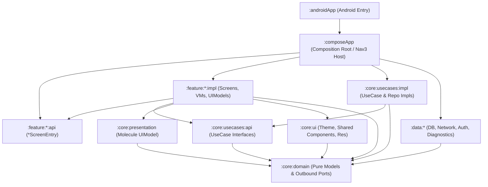

# GradingScale2

A multi-platform grading scale calculator built with Kotlin Multiplatform and Compose Multiplatform. GradingScale2 handles non-linear grading systems with precision, allowing educators and students to define custom grading scales and perform exact calculations across all major platforms.

## Features

### Core Functionality
- **Non-Linear Grade Calculations**: Support for complex, non-linear grading scales that accurately reflect various educational systems
- **Custom Grade Scale Management**: Create, edit, and manage multiple grading scales with different point systems and grade boundaries
- **Weighted Grade Calculator**: Calculate weighted averages for courses with different component weights (assignments, exams, projects)
- **Import Grade Scales**: Import pre-defined grading scales from various educational systems
- **Exam Table Export**: Export exam point/grade lookup tables as formatted HTML/Word or TSV to the clipboard with configurable columns, point/percentage ranges, and sorting
- **Real-time Calculations**: Instant grade calculations as you input scores
- **Multi-Scale Support**: Switch between different grading scales seamlessly

### Platform-Specific Features
- **Adaptive UI**: Responsive design that adapts to phones, tablets, and desktop screens
- **Offline-First**: All data stored locally for fast, reliable access
- **Material 3 Design**: Modern UI following the latest Material Design guidelines

## Architecture

### Hexagonal Architecture & API/Impl Modularization

The project follows **Hexagonal Architecture (Ports & Adapters)** combined with **feature-slice modularization** and strict **`:api` / `:impl` separation** across both features and use cases:

- **Hexagon Core (`:core:domain`, `:core:usecases:api`, `:core:usecases:impl`)**: `:core:domain` holds pure Kotlin domain models and outbound port interfaces (DAOs, network API, auth, diagnostics, clipboard, seed generator) with zero Compose or Koin dependencies. `:core:usecases:api` exposes pure Kotlin use case and export service interfaces, while `:core:usecases:impl` keeps all implementations and repository classes `internal`.
- **Driving Adapters — Feature Modules (`:feature:<name>:{api,impl}`)**: Four domain-aligned features (`gradescales`, `calculator`, `weightedcalculator`, `importer`). Each `:api` exposes its composable `*ScreenEntry` contract; each `:impl` encapsulates its Screens, ViewModels, Molecule UIModels/UIStates, dialogs, and Koin module as `internal`. Feature `:impl` modules depend only on `:api` modules and never on sibling `:impl` or `:data:*` modules.
- **Technical Core (`:core:presentation`, `:core:ui`)**: `:core:presentation` provides Molecule `UIModel` / `StateProducer` infrastructure; `:core:ui` hosts the shared Material 3 theme, adaptive components, snackbar feedback port/impl, and Compose Multiplatform string/seed resources.
- **Driven Adapters (`:data:*`)**: `:data:network`, `:data:authFirebase`, `:data:diagnostics`, and `:data:persistance:{db,sharedprefs,wasmjs-storage}` implement the outbound port interfaces from `:core:domain` without any transitive Compose or Molecule dependency.
- **Composition Roots (`:composeApp`, `:androidApp`)**: `:composeApp` is a thin app shell that assembles all Koin modules into `mainModule`, hosts Navigation 3 (`Destinations` + `MainNavHost`), and provides platform entry points (`Main`, `MainViewController`, `main`). `:androidApp` is the thin AGP 9 Android application wrapper.



### Key Architectural Decisions

#### Molecule for Reactive State Management
The project uses [CashApp's Molecule](https://github.com/cashapp/molecule) for state management, revolutionizing how UI state is handled by treating it as a Composable function:

```kotlin
interface UIModel<UIState, UICommand> {
    val stateProducer: StateProducer

    val uiState: StateFlow<UIState>

    val scope: CoroutineScope
        get() = stateProducer.scope

    fun sendCommand(command: UICommand)
}

interface UIModelWithEvents<UIState, UICommand, UIEvent> :
    UIModel<UIState, UICommand>,
    UIEventDispatcher<UIEvent>
```
**Benefits of Molecule:**
- **Reactive by Design**: UI state recomposes automatically when dependencies change
- **Testable**: State logic can be tested without Android framework dependencies
- **Composable Logic**: Leverage Compose's powerful state management primitives
- **Clear Data Flow**: Unidirectional data flow with commands, state, and optional one-off `UIEvent` channels (`UIModelWithEvents`)


It also separates the UIModel, from the Android Framework Specific UIModel, allowing easier testing and use in different platforms even without the Navigation/Jetpack ComposeUI. 

In case you require to link your UIModels to the Android or Jetpack ComposeUI Navigation/Lifecycle, you can then use a ViewModel and tie its scope into the ViewModel. The functionallity can be easily added via interface implementation with the `by` class delegation.

```kotlin
internal class CalculatorViewModel(
    calculatorUIModel: CalculatorUIModel,
) : ViewModel(calculatorUIModel.scope),
    UIModel<GradeScaleCalculatorUIState, CalculatorUIEvent> by calculatorUIModel
```
This keeps presentation state logic decoupled inside `:core:presentation` and encapsulated within each `:feature:*:impl` module while keeping `:composeApp` focused on app shell wiring.


#### Adaptive Layout, Navigation 3 & Persistent Scaffolds

Top-level navigation and adaptive chrome live in `:composeApp`, decoupled from feature implementations through `:feature:*:api` contracts:

- **`AppNavigationSuite`**: Wraps Material 3 `NavigationSuiteScaffold` using `currentWindowAdaptiveInfo()` to switch automatically between a bottom navigation bar (compact screens) and a navigation rail (landscape, tablet, and desktop).
- **`MainNavHost` (JetBrains Navigation 3)**: Uses `NavDisplay`, `entryProvider`, explicit polymorphic serialization of `Destinations : NavKey` in `SavedStateConfiguration` (required on non-JVM targets like iOS and WasmJS), and lazy Koin-injected `*ScreenEntry` interfaces from `:feature:*:api`.
- **`PersistentScaffold` & `ScaffoldState`**: Each destination wraps its content in `PersistentScaffold`, combining Navigation 3's `LocalNavAnimatedContentScope` with `SharedTransitionScope` (via `AppState`) for shared element transitions.

```kotlin
// :composeApp MainNavHost.kt
internal val navSavedStateConfiguration = SavedStateConfiguration {
    serializersModule = SerializersModule {
        polymorphic(NavKey::class) {
            subclass(Destinations::class)
        }
    }
}

NavDisplay(
    backStack = appNavController.backStack,
    entryDecorators = listOf(
        rememberSaveableStateHolderNavEntryDecorator(),
        rememberViewModelStoreNavEntryDecorator(),
    ),
    entryProvider = entryProvider {
        entry<Destinations> { destination ->
            when (destination) {
                Destinations.GradeScaleList -> {
                    val gradeScalesEntry = koinInject<GradeScalesScreenEntry>()
                    PersistentScaffold { gradeScalesEntry(Modifier.padding(it)) }
                }

                Destinations.GradeScaleCalculator -> {
                    val calculatorEntry = koinInject<CalculatorScreenEntry>()
                    PersistentScaffold { calculatorEntry(Modifier.padding(it)) }
                }

                Destinations.WeightedGradeCalculator -> {
                    val weightedCalculatorEntry = koinInject<WeightedCalculatorScreenEntry>()
                    PersistentScaffold { weightedCalculatorEntry(Modifier.padding(it)) }
                }

                Destinations.GradeImporter -> {
                    val importerEntry = koinInject<ImporterScreenEntry>()
                    PersistentScaffold { importerEntry(Modifier.padding(it)) }
                }
            }
        }
    },
)
```

**Key Features:**
- **Shared Element Transitions**: Smooth animations between screens using `SharedTransitionScope` (`AppState`)
- **State Persistence**: Saveable back stack and entry-scoped `ViewModelStore` across destinations
- **Adaptive Components**: Automatically switches between bottom bar and navigation rail based on window size class
- **Strict Feature Isolation**: `:composeApp` depends only on `:feature:*:api` `*ScreenEntry` contracts inside `MainNavHost`

#### Immutability with PersistentList

The project embraces functional programming principles by using **immutable data structures** throughout:

```kotlin
@Serializable
data class GradeScale(
    val id: String,
    val gradeScaleName: String,
    val totalPoints: Double,
    @Serializable(with = PersistentListSerializer::class)
    val grades: PersistentList<Grade>,
) {
    @Transient
    val sortedGrades = grades.sortedByDescending { it.percentage }.toImmutableList()
}
```

**Why PersistentList?**
- **Thread Safety**: Immutable collections are inherently thread-safe
- **Performance**: Structural sharing reduces memory overhead when creating modified copies
- **Predictability**: Data cannot be accidentally mutated, reducing bugs
- **Compose Integration**: Works seamlessly with Compose's recomposition system
- **Custom Serialization**: Handles WasmJS compatibility issues with a custom serializer

#### Reactive Everything with Kotlin Flows

The architecture is fully reactive using Kotlin Coroutines Flow:

```kotlin
internal interface GradeScaleRepository {
    fun getGradeScaleById(id: String): SharedFlow<GradeScale?>
    fun getGradeScales(): SharedFlow<ImmutableList<GradeScale>>
}

internal class GradeScaleRepositoryImpl(
    private val gradeScaleDao: GradeScaleDao,
    private val scope: CoroutineScope = CoroutineScope(CoroutineName("GradeScaleRepositoryImpl")),
) : GradeScaleRepository {
    override fun getGradeScales(): SharedFlow<ImmutableList<GradeScale>> =
        gradeScaleDao.getGradeScales()
            .shareIn(
                scope = scope,
                started = SharingStarted.Lazily,
                replay = 1,
            )
}
```

**Reactive Benefits:**
- **Real-time Updates**: UI automatically updates when data changes
- **Efficient Resource Usage**: `SharingStarted.Lazily` only activates flows when collected
- **Backpressure Handling**: Flow operators handle data stream pressure automatically
- **Cancellation Support**: Proper lifecycle management with structured concurrency

#### ⚡ Functional Error Handling with Arrow

The project uses [Arrow](https://arrow-kt.io/) for functional error handling, avoiding exceptions in favor of explicit error types:

```kotlin
// Using Option for nullable results (:core:usecases:impl)
internal class InsertGradeScaleUseCaseImpl(
    val gradeScaleRepository: GradeScaleRepository,
) : InsertGradeScaleUseCase {
    override suspend operator fun invoke(...): Option<String> = option {
        val currentScales = gradeScaleRepository.getGradeScales().firstOrNull() ?: persistentListOf()
        // Arrow's bind() for monadic composition
        gradeScaleRepository.upsertGradeScale(initialGradeScale).bind()
    }
}

// Using Either for operations that can fail (:core:usecases:impl)
internal interface RemoteSyncRepository {
    suspend fun countriesAndGrades(): Either<RemoteError, List<CountryGradingScales>>
}

// Clean error handling in UIModel / feature
when (val result = getRemoteGradeScales()) {
    is Either.Right -> updateUI(result.value)
    is Either.Left -> showError(result.value)
}
```

**Why Arrow?**
- **Type-Safe Errors**: Compile-time guarantee of error handling
- **Composable**: Chain operations without nested try-catch blocks
- **Explicit**: Makes error cases visible in function signatures
- **Functional**: Leverages monadic composition for clean code

#### Gradle Convention Plugins

The build system uses focused role-based convention plugins in `build-logic/src/main/kotlin/`:

- **`kmp-library-pure`**: Pure Kotlin KMP modules (`:core:domain`, `:core:usecases:api`) with no Compose or Koin dependencies
- **`kmp-library-di`**: `kmp-library-pure` + Koin Core & Koin Compiler Plugin (`:core:usecases:impl`)
- **`kmp-compose-runtime`**: `kmp-library-di` + Compose Runtime, Molecule, and Lifecycle ViewModel (`:core:presentation`)
- **`kmp-compose-feature-api`**: `kmp-library-pure` + Kotlinx Serialization, Compose UI, and Navigation 3 (`:feature:*:api`)
- **`kmp-compose-feature-impl`**: `kmp-compose-runtime` + Material 3, Compose Resources, and Koin Compose ViewModel (`:feature:*:impl`, `:core:ui`)

```kotlin
// feature/calculator/impl/build.gradle.kts
plugins {
    id("kmp-compose-feature-impl")
}

kotlin {
    androidLibrary {
        namespace = libs.versions.packagename + ".feature.calculator.impl"
    }

    sourceSets {
        commonMain.dependencies {
            implementation(projects.feature.calculator.api)
            implementation(projects.core.domain)
            implementation(projects.core.usecases.api)
            implementation(projects.core.presentation)
            implementation(projects.core.ui)
        }
    }
}
```

#### Dependency Injection with Koin

The project uses **Koin 4.2.2 with the Koin Compiler Plugin** (compile-time graph verification) and per-module Koin Compiler Plugin DSL:

```kotlin
// :feature:calculator:impl
val calculatorFeatureModule = module {
    factory<CalculatorUIModel>()
    viewModel<CalculatorViewModel>()
    single<CalculatorScreenEntry> {
        CalculatorScreenEntry { modifier ->
            GradeScaleCalculatorScreen(modifier = modifier)
        }
    }
}

// :composeApp composition root (MainModule.kt)
val mainModule = module {
    includes(
        getApplicationModule(),
        authModule,
        dbModule,
        networkModule,
        presentationModule,
        coreUiModule,
        usecasesModule,
        calculatorFeatureModule,
        importerFeatureModule,
        weightedCalculatorFeatureModule,
        gradeScalesFeatureModule,
        preferencesModule,
        diagnosticsModule,
    )
}
```

### Module Structure

```
GradingScale2/
├── androidApp/                 # Thin Android application entry point
├── composeApp/                 # Composition root (App shell, Nav3 host, Koin assembly, platform entrypoints)
│
├── core/                       # Technical & Domain Core
│   ├── domain/                 # Pure Kotlin domain models & outbound ports (DAOs, APIs, platform ports)
│   ├── usecases/
│   │   ├── api/                # Pure Kotlin use case & export service interfaces
│   │   └── impl/               # Internal use case, export service, and repository implementations + Koin module
│   ├── presentation/           # Molecule UIModel / StateProducer infrastructure
│   └── ui/                     # Shared Compose theme, components, Snackbar use case, and Compose resources
│
├── feature/                    # Feature Modules (API / Impl separation)
│   ├── gradescales/            # :api (*ScreenEntry) & :impl (List, CRUD & Export dialogs, VMs, UIModels)
│   ├── calculator/             # :api & :impl (Grade Scale Calculator)
│   ├── weightedcalculator/     # :api & :impl (Weighted Grade Calculator & dialog)
│   └── importer/               # :api & :impl (Remote Grade Scale Importer)
│
└── data/                       # Driven Adapters (Data / Infrastructure Layer)
    ├── network/                # Ktor HTTP client
    ├── authFirebase/           # Firebase authentication
    ├── diagnostics/            # Sentry diagnostics
    └── persistance/
        ├── db/                 # SQLDelight database / Web KStore
        ├── sharedprefs/        # KStore preferences
        └── wasmjs-storage/     # Web localStorage KStore backend
```

## Tech Stack

### Core Technologies
- **[Kotlin Multiplatform](https://kotlinlang.org/docs/multiplatform.html)** (2.4.21) - Share code across platforms
- **[Android Gradle Plugin](https://developer.android.com/build/releases/gradle-plugin)** (9.5.0) - `com.android.kotlin.multiplatform.library` with thin `:androidApp` entry point
- **[Compose Multiplatform](https://www.jetbrains.com/compose-multiplatform/)** (1.12.2) - Modern declarative UI framework
- **[Material 3 Adaptive](https://m3.material.io/)** (1.3.0) - Adaptive design system & Navigation Suite
- **[Haze](https://github.com/chrisbanes/haze)** (1.7.3) - Progressive blur / glassmorphism effects

### State Management & UI
- **[CashApp Molecule](https://github.com/cashapp/molecule)** (2.2.0) - Compose-based reactive state management
- **[JetBrains Navigation 3](https://kotlinlang.org/docs/multiplatform/compose-navigation-3.html)** (1.2.0) & **Lifecycle ViewModel Navigation 3** (2.11.0) - Type-safe multiplatform navigation

### Networking & Data
- **[Ktor](https://ktor.io/)** (3.6.1) - Multiplatform HTTP client
- **[SQLDelight](https://github.com/cashapp/sqldelight)** (2.4.1) - Type-safe SQL database (Android, iOS, JVM Desktop)
- **[Kotlinx Serialization](https://github.com/Kotlin/kotlinx.serialization)** (1.12.0) - JSON & polymorphic `NavKey` serialization
- **[KStore](https://github.com/xxfast/KStore)** (1.1.0) - Multiplatform file and web `localStorage` persistence

### Dependency Injection
- **[Koin](https://insert-koin.io/)** (4.2.2) & **Koin Compiler Plugin** (1.2.3) - Compile-time verified multiplatform DI

### Platform Integration & Observability
- **[Firebase](https://firebase.google.com/)** - Authentication & Analytics
  - Android/iOS/Desktop: GitLive Firebase SDK (2.7.0)
  - Web: Firebase JS interop
- **[Sentry KMP](https://docs.sentry.io/platforms/kotlin/guides/kotlin-multiplatform/)** (0.29.0) - Multiplatform crash reporting and diagnostics
- **[Conveyor](https://conveyor.hydraulic.dev/)** (2.0) - Desktop app distribution

### Code Quality
- **[Ktlint](https://pinterest.github.io/ktlint/)** - Kotlin code style enforcement
- **[Kotlinx Kover](https://github.com/Kotlin/kotlinx-kover)** (0.9.11) - Multiplatform line and branch code coverage measurement
- **[PITest (PIT)](https://pitest.org/)** (1.30.1) - Mutation testing to verify test suite quality and eliminate surviving mutants
- **[Arrow](https://arrow-kt.io/)** (2.3.0) - Functional programming and error handling (`Option`, `Either`, `Raise`)
- **[Kotlin Coroutines](https://github.com/Kotlin/kotlinx.coroutines)** (1.11.0) - Asynchronous programming
- **[Kotlinx Collections Immutable](https://github.com/Kotlin/kotlinx.collections.immutable)** (0.5.2) - Persistent & immutable collections

## 📱 Platform Support

| Platform | Status | Min Version | Notes |
|----------|--------|-------------|-------|
| Android  | ✅ | API 26 (8.0) | `compileSdk` 37, `targetSdk` 36 |
| iOS      | ✅ | iOS 15.3 | Native SwiftUI integration (`iosArm64`, `iosSimulatorArm64`) |
| Desktop  | ✅ | JVM 17 | Windows, macOS, Linux (packaged via Conveyor) |
| Web      | ✅ | Modern browsers | WasmJS target |

## 🚀 Getting Started

### Prerequisites
- JDK 17 or higher
- Android Studio (for Android development)
- Xcode 15+ (for iOS development)
- Node.js (for web development)

### Clone the Repository
```bash
git clone https://github.com/felix-leyva/gradingscale2.git
cd gradingscale2
```

### Build & Run

#### 🤖 Android
```bash
# Build debug APK
./gradlew :androidApp:assembleDebug

# Install on connected device
./gradlew :androidApp:installDebug
```

#### iOS
```bash
# Build iOS framework
./build-ios.sh

# Open in Xcode
open iosApp/iosApp.xcodeproj
```

#### Desktop
```bash
# Run desktop application
./gradlew :composeApp:run

# Create distribution
./gradlew :composeApp:packageDistributionForCurrentOS
```

#### Web
The web application (WasmJS) is live and available at **[https://gradingscale2.web.app](https://gradingscale2.web.app)**.

```bash
# Run development server
./gradlew :composeApp:wasmJsBrowserRun

# Build production distribution
./gradlew :composeApp:wasmJsBrowserDistribution

# Deploy to Firebase Hosting
firebase deploy --only hosting
```

Alternatively, the WebWasm version can be deployed using a Docker container. Inside `docker` are included the templates to build an nginx container and configure it to run the deployed wasmjs app (`build-wasmjs.main.kts`).

### Testing
```bash
# Run all JVM and Android host unit tests across all modules
./gradlew jvmTest
./gradlew testAndroidHostTest

# Run tests on specific modules
./gradlew :core:usecases:impl:jvmTest
./gradlew :feature:gradescales:impl:jvmTest
./gradlew :data:network:jvmTest
./gradlew :data:persistance:db:jvmTest

# Check code style
./gradlew ktlintCheck

# Auto-format code
./gradlew ktlintFormat

# Generate aggregated multiplatform code coverage report (Kover)
./gradlew koverHtmlReport

# Run PITest mutation testing on use cases, repositories, and data adapters
./gradlew :core:usecases:impl:pitestJvm :data:network:pitestJvm :data:persistance:db:pitestJvm

# Run PITest targeting a specific class or package
./gradlew :core:usecases:impl:pitestJvm -Ppitest.targetClasses="de.felixlf.gradingscale2.entities.usecases.*"
```

### Clean & Rebuild
```bash
# Use the helper script
./clean-and-rebuild.sh

# Or manually
./gradlew clean
./gradlew build
```

## Testing Strategy

The project employs a robust multi-tiered testing and quality assurance pipeline:

### 1. Multiplatform Unit Tests
Comprehensive test suites live in `commonTest` across modules, targeting:
- **Use Cases**: Validation of grading boundaries, point thresholds, and error handling with Arrow `Option`/`Either`.
- **UIModels & Molecule**: State emission testing with CashApp Turbine and test dispatchers.
- **Repositories & DAOs**: In-memory and fake DAO validation for persistence and network synchronization.

Example UIModel test structure:
```kotlin
@Test
fun `should update UI state when grade scale is selected`() = runTest {
    val sut = GradeListUIModel(...)

    sut.uiState.test {
        awaitItem() // initial state
        sut.sendCommand(GradeScaleListUIEvent.SelectGradeScale("Standard Scale"))
        
        val state = awaitItem()
        assertEquals("scale-1", state.selectedGradeScale?.id)
        cancelAndIgnoreRemainingEvents()
    }
}
```

### 2. Code Coverage with Kotlinx Kover
We track line, branch, and instruction coverage across all shared Kotlin Multiplatform code using **Kotlinx Kover**:
- **Multi-project Aggregation**: Aggregates coverage metrics across `:core:*`, `:feature:*`, `:data:*`, and `:composeApp`.
- **Filtered Metrics**: Excludes generated serialization code, build configs, and Compose/SQLDelight resources so numbers reflect handwritten business and UI logic.
- **Report Location**: Running `./gradlew koverHtmlReport` produces an interactive HTML report at `build/reports/kover/html/index.html`.

### 3. Mutation Testing with PITest (PIT)
Traditional code coverage verifies which lines were executed, but does not guarantee whether tests detect bugs. We use **PITest** to mutation-test use cases, repositories, export formatters, and data adapters in `:core:usecases:impl`, `:data:network`, and `:data:persistance:db`:
- **Fault Injection**: Automatically injects synthetic faults ("mutants") into compiled JVM bytecode—such as inverting conditionals (`>=` → `<`), mutating math operators (`+` → `-`), modifying boundary constants, and mutating return values.
- **Killed vs. Survived**: Mutants caught by failing tests are **Killed** (pass), while undetected mutants are **Survived** (fail), exposing weak assertions or missing edge cases.
- **Targeted Execution**:
  ```bash
  ./gradlew :core:usecases:impl:pitestJvm
  ./gradlew :data:network:pitestJvm
  ./gradlew :data:persistance:db:pitestJvm
  ```
- **Report Location**: HTML mutation test reports are generated under `<module>/build/reports/pitest/index.html` (for example, `core/usecases/impl/build/reports/pitest/index.html`).

## Download & Web App

- **Web App**: Available online at [https://gradingscale2.web.app](https://gradingscale2.web.app)
- **Desktop Application**: Available for download on the [Download Section](https://felix-leyva.github.io/gradingscale2/download)

## Contributing

Contributions are welcome! Please feel free to submit a Pull Request.

## License

This project is licensed under the MIT License - see the [LICENSE](LICENSE) file for details.
